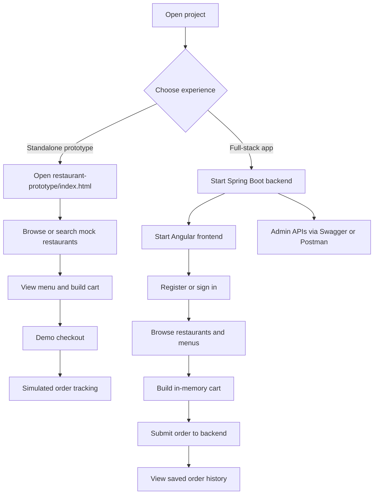

# Rukmini Eat

A restaurant discovery and food-ordering project with two runnable versions:

- **Standalone prototype**: browser-only experience with mock restaurant data and simulated checkout/tracking.
- **Full-stack app**: Angular frontend with a Java/Spring Boot API, JWT authentication, and an in-memory H2 database.

## Project Flow



## Repository Layout

| Path | Contents |
|---|---|
| [feature-rukamini-eat/restaurant-app/restaurant-prototype](feature-rukamini-eat/restaurant-app/restaurant-prototype) | Standalone HTML/CSS/JavaScript prototype; mock data only. |
| [feature-rukamini-eat/restaurant-app/rukmini-eat-app](feature-rukamini-eat/restaurant-app/rukmini-eat-app) | Full-stack application, API docs, and Postman collection. |
| [rukmini-eat-backend](feature-rukamini-eat/restaurant-app/rukmini-eat-app/rukmini-eat-backend) | Spring Boot REST API, security, persistence, and tests. |
| [rukmini-eat-frontend](feature-rukamini-eat/restaurant-app/rukmini-eat-app/rukmini-eat-frontend) | Angular single-page application and tests. |

## Run the Standalone Prototype

Open [index.html](feature-rukamini-eat/restaurant-app/restaurant-prototype/index.html) directly in a browser, or run a local static server from the prototype directory:

```powershell
Set-Location .\feature-rukamini-eat\restaurant-app\restaurant-prototype
npx serve .
```

It runs without a backend, build step, or installed project dependencies. Regression tests:

```powershell
node --test app.test.cjs
```

The prototype has 126 mock restaurants, natural-language and typo-tolerant search, filters and sorting, menus, cart/coupon logic, demo sign-in, and simulated order tracking. It does not authenticate against the backend, use real provider data, take payments, or submit real orders. See the [prototype README](feature-rukamini-eat/restaurant-app/restaurant-prototype/README.md) for its feature, data, and responsive-design details.

## Run the Full-Stack App

The commands below are for PowerShell. Start in the repository root, then change to the application directory:

```powershell
Set-Location .\feature-rukamini-eat\restaurant-app\rukmini-eat-app
```

### Requirements

- Java 17 and Maven
- Node.js 20.19 or later for the Angular frontend
- No external database or Docker required for local development; H2 runs in memory

Build and test the backend:

```powershell
mvn clean install
```

Start the backend on port 8080 with the `local` profile. The context path is `/rukmini-eat`; this profile seeds demo data and enables Swagger UI.

```powershell
mvn -f .\rukmini-eat-backend\pom.xml spring-boot:run "-Dspring-boot.run.profiles=local"
```

Start the frontend in a second terminal (from the `rukmini-eat-app` directory):

```powershell
npm.cmd --prefix .\rukmini-eat-frontend install
npm.cmd --prefix .\rukmini-eat-frontend start
```

Open <http://localhost:4200>.

Without the `local` profile the application starts without demo users, restaurants, Swagger UI, or the H2 console. It requires a `JWT_SECRET` environment variable of at least 32 bytes:

```powershell
$env:JWT_SECRET = "<random string of 32+ characters>"
mvn -f .\rukmini-eat-backend\pom.xml spring-boot:run
```

Local demo accounts (seeded only with the `local` profile):

| Role | Email | Password |
|---|---|---|
| Customer | demo@rukmini.com | Demo@123 |
| Admin | admin@rukmini.com | Admin@123 |

## Full-Stack User Flow

1. Register a customer or sign in at `/login`.
2. Browse restaurants, search, filter, and sort at `/restaurants`.
3. Open a restaurant at `/restaurants/:id` and add dishes to the cart.
4. Review the cart at `/cart`. The cart is held in frontend memory and is not a separate backend resource.
5. Place the order. The backend validates menu items and quantities, enforces the single-restaurant rule, and recalculates totals from database prices.
6. Review saved order history at `/orders`.

Admin restaurant/menu operations and provider-readiness status are API-only; use Swagger UI or Postman. All frontend routes except `/login` require a signed-in user. The local prototype has its own separate mock-data flow and browser-local cart/order history.

## Screens

1. **Login / Create account**: tabbed form with validation and server error messages.
2. **Restaurant dashboard**: greeting, stats, cuisine strip, search, filters (pure veg, rating, fast), and sorting.
3. **Restaurant menu**: category-grouped dishes, veg/non-veg markers, and add to cart.
4. **Cart**: quantity steppers, free-delivery progress, bill breakdown, and place order.
5. **My orders**: order history with status and totals.

## API

Backend origin and context: **http://localhost:8080/rukmini-eat**. API paths below are relative to that URL.

### Swagger / OpenAPI

| Resource | URL |
|---|---|
| Swagger UI | <http://localhost:8080/rukmini-eat/swagger-ui/index.html> |
| OpenAPI JSON | <http://localhost:8080/rukmini-eat/v3/api-docs> |
| OpenAPI YAML | <http://localhost:8080/rukmini-eat/v3/api-docs.yaml> |

Documentation is publicly readable; application APIs remain secured. Swagger generates request/response schemas and validation constraints from backend DTOs. Its description also lists frontend routes and the backend operations each screen calls.

A static OpenAPI snapshot is at [docs/openapi.yaml](feature-rukamini-eat/restaurant-app/rukmini-eat-app/docs/openapi.yaml). Regenerate it after changing endpoints with the backend running, then rebuild the HTML pages (commands run from the `rukmini-eat-app` directory):

```powershell
Invoke-WebRequest http://localhost:8080/rukmini-eat/v3/api-docs.yaml -OutFile .\docs\openapi.yaml
.\docs\build-html.ps1
```

| Static page | Purpose |
|---|---|
| [docs/index.html](feature-rukamini-eat/restaurant-app/rukmini-eat-app/docs/index.html) | Overview of base URLs, endpoints, frontend routes, authentication, and errors. |
| [docs/swagger.html](feature-rukamini-eat/restaurant-app/rukmini-eat-app/docs/swagger.html) | Offline Swagger reference for endpoints and schemas; use live Swagger UI to execute requests. |

`docs/assets/` contains bundled Swagger UI 5.32.2 files (Apache License 2.0) and generated `openapi-spec.js`. Do not edit `openapi-spec.js`; rerun `build-html.ps1`.

To use live Swagger UI:

1. Open Swagger UI and expand **Authentication**.
2. Try `POST /api/auth/login` with a demo account, or register with `POST /api/auth/register`.
3. Copy the `token` from the response.
4. Click **Authorize** and paste only the token, without the `Bearer ` prefix.
5. Execute restaurant and order operations. Admin operations require the admin login; registration always creates a customer.

Swagger UI and OpenAPI endpoints are available with the `local` profile only. To enable them elsewhere, set `SPRINGDOC_API_DOCS_ENABLED=true` and `SPRINGDOC_SWAGGER_UI_ENABLED=true`; they are disabled by default.

### REST Endpoints

| Tag | Method | Path | Access | Request | Responses |
|---|---|---|---|---|---|
| Authentication | POST | `/api/auth/register` | Public | `{name, email, password}` | 201 token + user; 400; 409 duplicate email; 429 |
| Authentication | POST | `/api/auth/login` | Public | `{email, password}` | 200 token + user; 400; 401; 429 |
| Restaurants | GET | `/api/restaurants` | Authenticated | Query: `q`, `cuisine`, `vegOnly`, `topRated`, `fast`, `sort` | 200 summaries; 401 |
| Restaurants | GET | `/api/restaurants/{id}` | Authenticated | Path: `id` | 200 restaurant + menu; 401; 404 |
| Orders | POST | `/api/orders` | Authenticated | `{items: [{menuItemId, quantity}]}` | 201 order with server-calculated totals; 400; 401 |
| Orders | GET | `/api/orders` | Authenticated | None | 200 own orders, newest first; 401 |
| Administration | POST | `/api/admin/restaurants` | `ADMIN` | `{name, cuisines, rating, etaMinutes, costForTwo, pureVeg, emoji?, description?}` | 201 summary; 400; 401; 403 |
| Administration | POST | `/api/admin/restaurants/{id}/menu-items` | `ADMIN` | `{name, category, price, veg, bestseller, emoji?}` | 201 menu item; 400; 401; 403; 404 |
| Provider integrations | GET | `/api/integrations/providers` | Authenticated | None | 200 static readiness status; 401 |

Swagger also shows each request/response schema, validation limits, and examples.

Restaurant search accepts optional `q` (name, cuisine, or dish), `cuisine` (substring), `vegOnly`, `topRated` (rating >= 4.3), `fast` (ETA <= 25 minutes), and `sort` (`relevance`, `rating`, `eta`, `costLow`, `costHigh`). Boolean filters default to `false`; default sort is `relevance`.

Order request example (replace `1` with a menu item ID from a restaurant response):

```json
{
	"items": [{ "menuItemId": 1, "quantity": 2 }]
}
```

Common errors: `400` invalid input, `401` missing/invalid token or bad login, `403` customer attempting admin operations, `404` unknown restaurant, `409` duplicate registration, and `429` too many login/registration attempts (see `Retry-After`). Application validation/business errors return `{"message":"..."}`; security-layer errors may have an empty body.

### Frontend Routes and API Connections

The Angular frontend runs at **http://localhost:4200**. It renders screens that call the backend; it is not a REST server.

| Frontend route | Screen / behavior | Backend calls |
|---|---|---|
| `/login` | Login and registration tabs; guest-only | `POST /api/auth/login`, `POST /api/auth/register` |
| `/restaurants` | Dashboard, search, filters, sorting | `GET /api/restaurants` |
| `/restaurants/:id` | Restaurant details and menu | `GET /api/restaurants/{id}` |
| `/cart` | In-browser cart; authenticated checkout | `POST /api/orders` |
| `/orders` | Own order history | `GET /api/orders` |
| `/` or unknown route | Redirect to `/restaurants`, then `/login` if signed out | None directly |

There are no dedicated admin or provider-integration screens; those APIs can be exercised in Swagger. Cart contents are held in frontend memory, not persisted by a separate cart API.

The shared frontend environment at [environment.ts](feature-rukamini-eat/restaurant-app/rukmini-eat-app/rukmini-eat-frontend/src/environments/environment.ts) sets `apiUrl` to `http://localhost:8080/rukmini-eat/api`. The authentication service and restaurant/order API client use it; the HTTP interceptor attaches the JWT to protected requests. If the backend host, port, or context changes, update this value and rebuild. For a different frontend origin, also update backend `app.cors.allowed-origins` (default `http://localhost:4200`).

Send the token as `Authorization: Bearer <jwt>`.

### Postman

The collection at [postman/Rukmini-Eat.postman_collection.json](feature-rukamini-eat/restaurant-app/rukmini-eat-app/postman/Rukmini-Eat.postman_collection.json) covers every API operation. Import it with [the local JSON environment](feature-rukamini-eat/restaurant-app/rukmini-eat-app/postman/Rukmini-Eat.local.postman_environment.json), or use the workspace environment at `postman/Rukmini EAT - Local.environment.yaml`. The environment's `baseUrl` includes the `/rukmini-eat` context path. For a customer flow, run **Login as customer**, **Search restaurants**, **Get restaurant details**, **Place order**, then **Get my order history**. For admin writes, run **Login as admin**, **Create restaurant**, then **Add menu item**.

## Tests

### Backend

JUnit 5 with an in-memory H2 database; no external services. Run from the `rukmini-eat-app` directory:

```powershell
mvn -f .\rukmini-eat-backend\pom.xml verify
```

`verify` runs all tests, writes the JaCoCo report to `rukmini-eat-backend/target/site/jacoco/index.html`, and fails the build if line coverage drops below 90% (override with `-Djacoco.min.line.coverage=0.8`). Use `test` instead of `verify` to skip the coverage gate. The documented result is 89 tests, about 99% line coverage.

| Test classes | Coverage |
|---|---|
| `AuthApiIntegrationTest` | Registration/login validation, duplicate emails, error messages, demo roles, JWT claims |
| `RestaurantApiIntegrationTest` | Search, filters and sorts, boundaries, detail/menu, 404 and bad IDs |
| `OrderApiIntegrationTest` | Pricing totals, line merging, quantity limits, invalid requests, one-restaurant rule, per-customer history |
| `AdminApiIntegrationTest` | Creating restaurants/menu items, validation, 403/401 for non-admins |
| `SecurityApiIntegrationTest` | Expired, forged, tampered and wrong-issuer tokens, auth schemes, CORS, 404/405/415 handling, stateless responses |
| `RateLimitIntegrationTest`, `AuthRateLimiterTest` | Login/registration throttling (429, `Retry-After`, CORS headers, window reset) |
| `NonLocalProfileIntegrationTest`, `SecurityConfigTest`, `DataSeederIntegrationTest` | No demo data, Swagger, or H2 console outside `local`; JWT secret rules; idempotent seeding |
| `OpenApiIntegrationTest` | Swagger/OpenAPI document, public docs, full register-to-order flow |
| `PricingTest`, `JwtServiceTest`, `GlobalExceptionHandlerTest`, `ProviderIntegrationControllerTest` | Unit tests |

Integration test classes share cached application contexts and create uniquely named data, so they can run in any order.

### Frontend

Jest with `jest-preset-angular` and jsdom (no browser needed). Run from the `rukmini-eat-app` directory:

```powershell
npm.cmd --prefix .\rukmini-eat-frontend test
npm.cmd --prefix .\rukmini-eat-frontend run test:ci
```

`test:ci` also writes coverage to `rukmini-eat-frontend/coverage/index.html` and fails below thresholds in `jest.config.js` (80% lines/statements/functions, 70% branches). The documented result is 91 tests, about 98% line coverage. Specs cover `AuthService`, route guards and routes, the auth interceptor, `CartService`, `ApiService`, the app shell, and login, dashboard, restaurant detail, cart, and orders pages.

Prototype tests are dependency-free and run from its directory with `node --test app.test.cjs`.

## Security

- **Profiles:** demo accounts, sample restaurants, Swagger UI, and H2 console exist only with the `local` profile.
- **JWT:** HS256, 60-minute lifetime, issuer `rukmini-eat` is validated. `JWT_SECRET` (32+ bytes) is mandatory outside `local`; the public development key is rejected there.
- **Throttling:** `POST /api/auth/login` and `/register` allow 20 attempts per client address per endpoint per 60 seconds, then return 429. Configure with `app.security.rate-limit.max-attempts` (0 disables) and `app.security.rate-limit.window-seconds`. Counters are in memory and keyed by connection address, so behind a reverse proxy enable `server.forward-headers-strategy` and use a shared store for multiple instances.
- **Dependencies:** Spring Boot 4.0.8; `npm audit` reports 0 vulnerabilities. To scan the backend against the NVD with OWASP dependency-check (opt-in; requires a free NVD API key, otherwise the first download is extremely slow):

	```powershell
	$env:NVD_API_KEY = "<your key>"
	mvn -f .\rukmini-eat-backend\pom.xml -Psecurity verify
	```

	The build fails on CVSS 7 or higher; the report is written to `rukmini-eat-backend/target/dependency-check-report.html`. The scan is optional and was not run for this documentation update.
- The frontend uses an npm `overrides` entry for `js-yaml` so that the Jest toolchain installs a patched version.

## Zomato / Swiggy Integration Preparation

Neither provider is connected. The standalone prototype uses mock restaurants and demo checkout. No outbound provider requests are made.

`GET /api/integrations/providers` is authenticated using the existing bearer-token flow. It reports `AWAITING_APPROVED_API_CONTRACT`, `liveData: false`, and `realOrdering: false` for both providers. This is an implementation-readiness status, not an external provider health check. The standalone prototype displays a static disclosure; it does not call this endpoint or use its demo-login flag as a backend JWT.

Reserved Spring configuration reads these optional server environment variables:

| Provider | Base URL | Credential |
|---|---|---|
| Zomato | `ZOMATO_API_BASE_URL` | `ZOMATO_API_KEY` |
| Swiggy | `SWIGGY_API_BASE_URL` | `SWIGGY_API_KEY` |

These values are not consumed by an HTTP client yet. Setting them does not activate an integration. Do not put credentials in frontend JavaScript, browser storage, committed configuration, or shared chat. Configure secrets in the backend process environment or a deployment secret store. Do not assume either provider authenticates using an API key: the approved contract must determine the eventual mechanism.

Before implementation, obtain approved partner access and documentation covering permitted restaurant discovery, menu endpoints, authentication, rate limits, attribution, and data retention. Zomato's [developer documentation](https://www.zomato.com/developer/integration/docs/overview/) describes POS integration; this does not establish access to general consumer restaurant discovery. Confirm the supported product directly with each provider. No undocumented consumer endpoints or scraping are used.

Next, implement and test provider-specific server adapters against approved response schemas, map data into the application's restaurant/menu contracts, and connect the prototype through an authenticated backend flow. Real provider ordering is a separate integration requiring explicit approval, documented checkout/payment flows, and end-to-end tests; existing local orders are not sent to Zomato or Swiggy.

## Backend Implementation Notes

- Order prices are recalculated on the server from database prices; the cart total in the UI is only an estimate.
- Pricing: delivery ₹40 (free from ₹399), GST 5%, platform fee ₹5.
- The current database configuration uses H2 (override with `DB_URL`, `DB_USERNAME`, `DB_PASSWORD`; an external database also needs its JDBC driver). `JWT_SECRET` (32+ bytes) is required outside the `local` profile.
- The token is kept in `localStorage` for simplicity; use an HttpOnly cookie flow for production.
- Schema is managed with `ddl-auto=update`; use Flyway or Liquibase for production.

## Additional Documentation

- [Full-stack app README](feature-rukamini-eat/restaurant-app/rukmini-eat-app/README.md)
- [Standalone prototype README](feature-rukamini-eat/restaurant-app/restaurant-prototype/README.md)
- [Project notes](feature-rukamini-eat/restaurant-app/POC%20details.txt)
